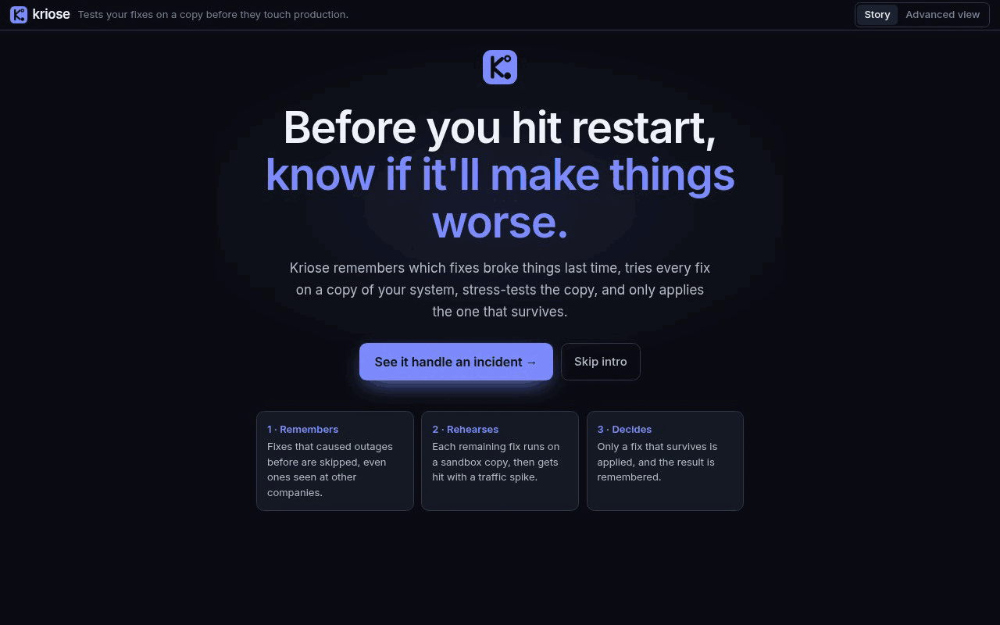
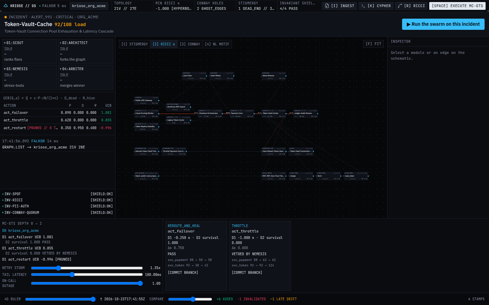
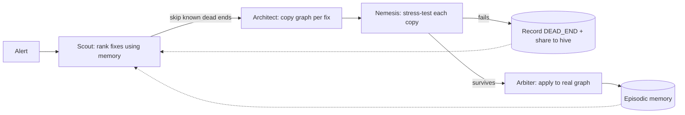

# Kriose: an incident agent that remembers what went wrong

> Most AI agents pick the first fix in the runbook. Kriose checks its memory,
> rehearses every fix on a sandbox copy of your system, stress-tests it, and
> only applies the one that survives.



**The demo incident:** Token-Vault is at 92% capacity. There are three possible fixes:
- **Restart** is skipped. The graph remembers it caused an outage last time, and another company hit the same failure.
- **Throttle** is tried in a sandbox, then fails under a simulated traffic spike, so it's rejected.
- **Failover to standby** survives the stress test. It's applied and remembered for next time.

Kriose stores everything in a [FalkorDB](https://www.falkordb.com/) graph. Four agents (Scout, ShadowArchitect, Nemesis, Arbiter) coordinate by reading and writing edges, and each "sandbox" is a `GRAPH.COPY` of the real graph.

## Try it live (no install)

The workstation has a frontend-only **demo mode** that replays a run recorded from the real backend: the seeded Acme graph plus every swarm event, paced so you can follow it. It turns on when `NEXT_PUBLIC_DEMO_MODE=1`, when you add `?demo-data=1` to the URL, or automatically when the API can't be reached (add `?live=1` to opt out). The top bar shows `DEMO · RECORDED` when it's active.

Deploy your own copy on Vercel:

1. Import the repo on [vercel.com/new](https://vercel.com/new) and set **Root Directory** to `frontend`. `frontend/vercel.json` already sets `NEXT_PUBLIC_DEMO_MODE=1`.
2. Or from the CLI: `cd frontend && vercel deploy`

Re-record the demo data from a running stack with `scripts/record-demo.sh`.

## Prerequisites

- [Docker Desktop](https://www.docker.com/products/docker-desktop/) (Windows/macOS), or Docker Engine with the Compose v2 plugin on Linux. Make sure it is running.
- Free ports: **3001** (workstation), **8000** (API), **6379** and **3000** (FalkorDB and its browser).

## Quickstart

**bash (macOS / Linux / Git Bash)**
```bash
git clone https://github.com/Kayd-06/Kriose && cd Kriose
docker compose up --build -d
# wait ~10s for the API, then load the demo incident into FalkorDB:
curl -X POST http://localhost:8000/api/v2/seed
# open http://localhost:3001 and click "▶ Run the swarm on this incident"
```

**PowerShell (Windows)**
```powershell
git clone https://github.com/Kayd-06/Kriose; cd Kriose
docker compose up --build -d
curl.exe -X POST http://localhost:8000/api/v2/seed
Start-Process http://localhost:3001
```

Shortcut: http://localhost:3001/?demo=1 runs the swarm automatically. Stop everything with `docker compose down`.

## What you'll see



1. **Top bar** – `FALKOR` connection badge, the graph `kriose_org_acme`, node/edge counts and the lowest curvature (κ).
2. **Incident header** – Token-Vault saturated, with the **▶ Run the swarm on this incident** button.
3. **Graph** – services and their dependencies. Scroll to zoom, hold Space to pan, press `F` to fit. Keys `1`–`4` switch lenses (memory, curvature, Conway ghosts, hive hashes).
4. **Swarm panel (left)** – the four agents light up in turn with a one-line summary each.
5. **Verdict cards** – after the run: Restart *skipped (dead end)*, Throttle *vetoed by INV-SPOF*, Failover *merged, survival 1.0*.

## How it works


## Glossary
| Term | Plain meaning |
|---|---|
| Pheromone | A learned weight for how often a fix has worked before |
| DEAD_END | A fix that's recorded as having failed |
| Nemesis | An adversarial stress test run on a sandbox copy |
| Shield (e.g. INV-SPOF) | A safety rule that vetoes a fix, e.g. "don't leave a tier-1 service with no spare capacity" |
| Hive | Anonymized failure memory shared across companies |
| Ricci κ | A bottleneck score for a dependency (negative means a single point of failure) |
| Conway ghost | Dependent services whose owners never talk to each other |

Deep dive: [Architecture](docs/ARCHITECTURE.md) · Story: [Blog post](BLOG.md) · Product spec: [PRD](PRD_&_ARCHITECTURE.md)

## Run (details)


```powershell
docker compose up --build
```

| Process | URL |
|---|---|
| API | http://localhost:8000 |
| Workstation | http://localhost:3001 |
| FalkorDB Browser | http://localhost:3000 |

First-run seed is required; then open the workstation. It polls health every 5 seconds and loads the first tenant graph. Click **Run the swarm on this incident**, or open http://localhost:3001/?demo=1 to run it automatically. Press `F` to zoom the schematic to fit.

```powershell
curl.exe -X POST http://localhost:8000/api/v2/seed
curl.exe -N -X POST "http://localhost:8000/api/v2/swarm/simulate?tenant=org_acme&alert_id=alert_991"
```

The `done` event's `detail.winner.action_id` is `act_failover` and `detail.winner.survival` is `1.0`.

API and workstation against a Falkor container you already started:

```powershell
py -3 -m venv .venv
.\.venv\Scripts\python -m pip install -r backend\requirements.txt
$env:FALKORDB_HOST = "localhost"
.\.venv\Scripts\python -m uvicorn main:app --app-dir backend --port 8000
```

The engine connects to FalkorDB lazily. The API starts without it, `GET /api/v2/health` reports `ok: false` until FalkorDB answers, and the next call reconnects.

```powershell
cd frontend
npm install
npm run dev
```

`NEXT_PUBLIC_API_BASE` (origin, as in Compose) and `NEXT_PUBLIC_API_URL` (full `/api/v2` prefix) both work. The default is `http://localhost:8000/api/v2`.

Tests need FalkorDB on port 6379:

```powershell
.\.venv\Scripts\python -m pytest backend\tests -q
```

MCP:

```powershell
.\.venv\Scripts\python backend\mcp_server.py
```

## Repository

```text
backend/engine.py          seed, curvature, time, ghosts, hive, shields, shock, snapshot
backend/swarm.py           Scout, ShadowArchitect, Nemesis, Arbiter
backend/compiler.py        vault.py, spans, RFC-409, Slack
backend/main.py            HTTP and SSE
backend/mcp_server.py      FastMCP tools
backend/fixtures/          synthetic repo, spans, RFC, Slack
backend/tests/             incident outcome
frontend/src/lib/          browser math, in-memory Cypher, fixture compiler, layout
frontend/src/services/     API client
frontend/src/components/   workstation
PRD_&_ARCHITECTURE.md      product spec
docs/ARCHITECTURE.md       graph model, formulas, API, workstation reference
BLOG.md                    incident write-up
```

`BLOG.md` narrates this incident. The screen it calls the command page is the workstation above. Seed and simulate are the API calls in [Run](#run-details).

## Tracks

One incident is entered in all three tracks.

- **Agents That Act on Connected Data.** The agent forks futures with `GRAPH.COPY`, shocks them, and commits failover because the graph says restart is a dead end and throttle breaks tier-1 capacity.
- **Agent Memory and Coordination.** `PHEROMONE_TRACE`, `DEAD_END`, `EpisodicMemory`, and the hive motif are what the next session reads. The second simulate skips both vetoed actions.
- **Company Brain.** Ownership, `COMMUNICATED_WITH`, and `SILENT_COLLISION_RISK` are the org model. RFC-409 and the contradicting Slack note are stored on the same graph.

